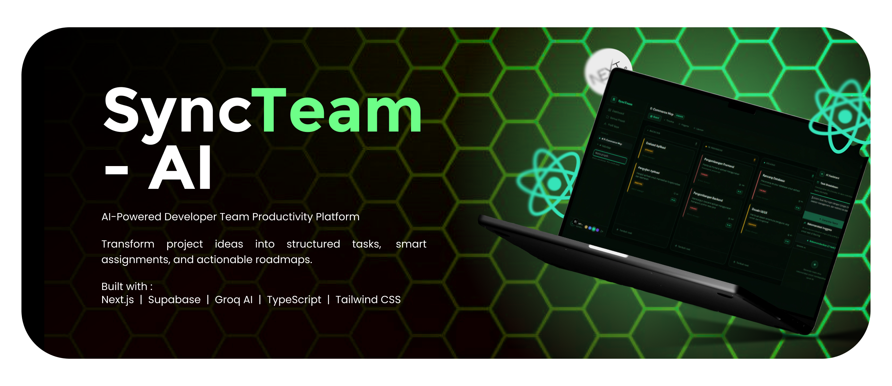
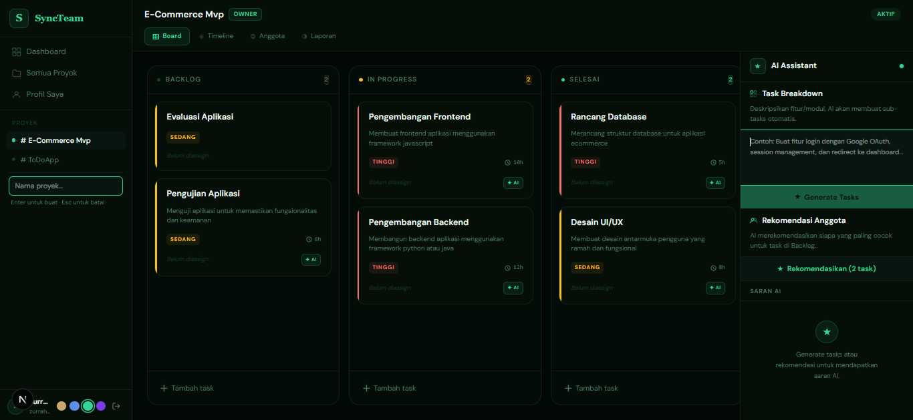
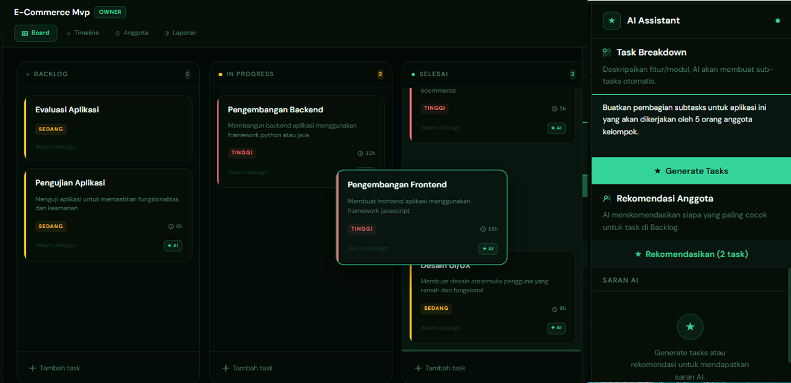
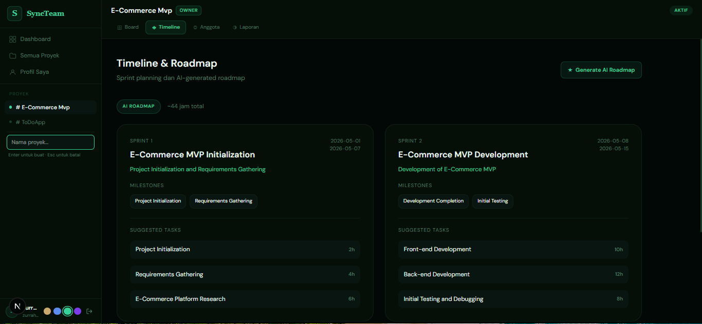
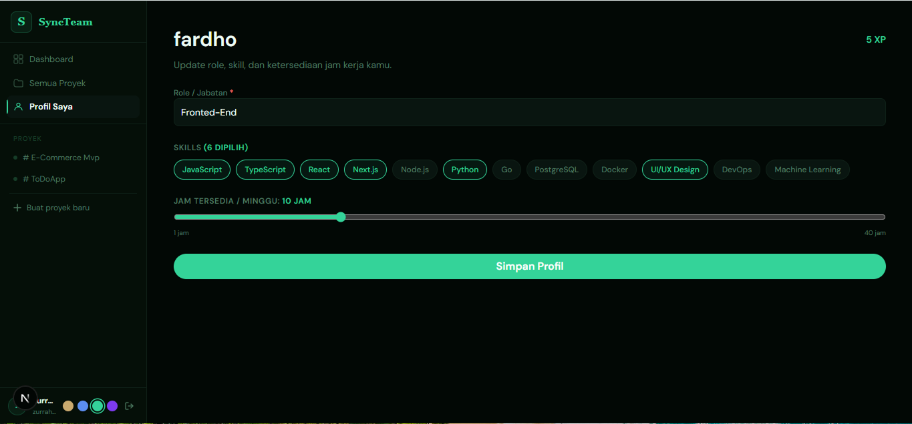
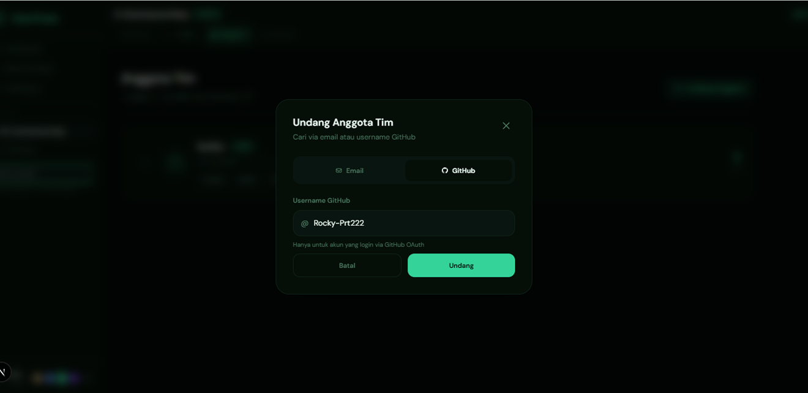
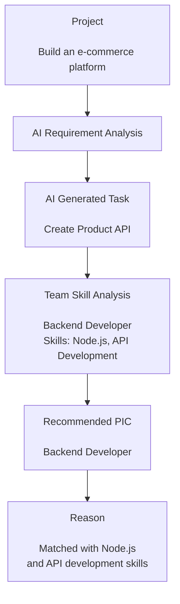

# SyncTeam-AI

<p align="center">
  
</p>

  AI-Powered Developer Team Productivity Platform. 
  
  An intelligent project management platform that helps developer teams plan, assign, collaborate, and track productivity using AI.

<p align="center">
  <a href="https://syncteam-ai.vercel.app">Live Demo</a>
  •
  <a href="#features">Features</a>
  •
  <a href="#installation">Installation</a>
</p>

<p align="center">


</p>

<p align="center">


</p>

---

## Overview

**SyncTeam-AI** is an AI-powered collaboration platform designed to help software development teams manage projects more effectively.

The platform combines project management, AI assistance, team collaboration, and productivity analytics into a single workspace.

Unlike traditional task management applications, SyncTeam-AI helps teams not only create tasks but also generate project roadmaps, break down complex requirements, and recommend task ownership based on team members' skills and activity.

Originally initiated as a team project, this version was independently continued, refined, redesigned, and enhanced into the current implementation with improved functionality, user experience, and AI integration.

---

# Application Preview

<p align="center">
  
  
</p>

<p align="center">
  
  
</p>

<p align="center">
  
  
</p>

---

# Features
## AI-Powered Project Planning
### AI Workflow

SyncTeam-AI integrates Large Language Models into the project management workflow, transforming project requirements into structured development plans.

The AI workflow consists of:

### AI Task Breakdown

Generate structured development tasks automatically from project descriptions.

The AI helps transform high-level ideas into actionable engineering tasks.

### AI Roadmap Generation

Create development roadmaps that guide teams from project initialization until completion.

### Smart Task Assignment

SyncTeam-AI uses AI reasoning to recommend task ownership based on team capabilities.

The system analyzes:

- Developer skills
- Profile information
- Team activity
- Project requirements

Then AI recommends the most suitable PIC for each generated task.

---

## Intelligent Task Assignment

Unlike conventional task management systems, SyncTeam-AI does not only generate task lists.

The AI considers:

- Team member skills
- Developer profiles
- Available contributors
- Previous activity data

to recommend suitable task ownership.

Example:

Instead of only generating a list of tasks, SyncTeam-AI analyzes project requirements and team capabilities to recommend suitable task ownership.

### Project Input



The recommendation process considers:

Developer skills
Team member profiles
Project requirements
Available contributors

This approach helps teams reduce planning time, improve task distribution, and ensure each task is assigned to the most suitable team member.

---

## Project Management

- Create and manage projects
- Organize development tasks
- Monitor project progress
- Drag and drop task management
- Track project activities

---

## Team Collaboration

- User authentication
- Invite team members
- Collaborative project workspace
- Developer profile management
- Skill-based member information

---

## Productivity & Gamification
### Individual XP System

Members receive experience points based on:

- Completed tasks
- Project activity
- Contribution progress
- Added skills

### Team Leaderboard

Monitor team contribution through ranking based on accumulated XP.

### Reports

View team productivity reports containing:

- Username
- Earned XP
- Individual contribution overview

---

## User Experience

- Modern dashboard interface
- One-click theme switching
- Responsive design
- Clean developer workspace experience

---

# Tech Stack

## Frontend

- Next.js 16
- React 19
- TypeScript
- Tailwind CSS 4

## Backend & Database

- Supabase
- Supabase Authentication
- Supabase Database
- Supabase SSR

## Artificial Intelligence

- Groq API
- Groq SDK
- Llama 3.3 70B Versatile

AI capabilities:
- Task breakdown generation
- Project roadmap generation
- Smart task assignment recommendation

## Libraries

- Zod - Schema validation and type-safe data handling
- Hello Pangea DnD - Drag and drop interaction

## Deployment

- Vercel

---

# Architecture Overview

SyncTeam-AI follows a modern full-stack architecture:

```
Frontend
   |
   |
Next.js Application
   |
   |
Supabase
   |
   ├── Authentication
   ├── Database
   └── User Management


AI Layer

Next.js Server Environment
   |
   |
Groq API
   |
   |
AI Task Generation
AI Roadmap Generation
AI Assignment Recommendation
```

---

# Project Structure

```
syncteam-ai
│
├── app
│   └── Next.js App Router
│
├── components
│   └── Reusable UI Components
│
├── hooks
│   └── Custom React Hooks
│
├── lib
│   └── Application Utilities
│
├── types
│   └── TypeScript Definitions
│
├── supabase
│   └── Database Migrations
│
├── public
│   └── Static Assets
│
└── package.json
```

---

# Installation

## Prerequisites

Make sure you have installed:

- Node.js 20+
- npm / pnpm
- Supabase account
- Groq API account


## Clone Repository

```bash
git clone https://github.com/fardhoz25/syncteam-ai.git

cd syncteam-ai
```


## Install Dependencies

```bash
npm install
```

---

# Environment Variables

Create a `.env.local` file:

```env
NEXT_PUBLIC_SUPABASE_URL=

NEXT_PUBLIC_SUPABASE_ANON_KEY=

SUPABASE_SERVICE_ROLE_KEY=

GROQ_API_KEY=

NEXT_PUBLIC_APP_URL=
```

---

# Run Development Server

```bash
npm run dev
```

Open:

```
http://localhost:3000
```

---

# Production Build

Create production build:

```bash
npm run build
```

Run production server:

```bash
npm start
```

---

# Database Setup

This project uses Supabase migrations.

Apply database migrations through Supabase:

```
supabase/migrations
```

---

# Future Improvements

Potential improvements:

- More advanced AI recommendation system
- Real-time team collaboration
- Notification system
- More detailed productivity analytics
- Mobile application support

---

# License

This project is licensed under the **MIT License**.

See the [LICENSE](LICENSE) file for details.

---

# Author

**Fardho Zurrahman**

Software Engineer | AI Engineer 

GitHub:
https://github.com/fardhoz25

---

<p align="center">
  Built with Next.js and Supabase.
</p>
